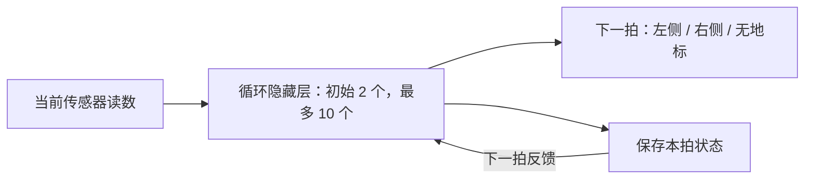

# 最多 10 个循环神经元的路线记忆实验

一台小车进入走廊，在入口短暂看到一块彩色标记。标记随后离开视野，小车仍要提前判断下一处地标会出现在左边、右边，还是下一拍不会有地标。不同路线在相同时刻可能有不同答案。实验把这个问题简化成 12 拍的模拟预测任务。



“五个输入通道”对应五种入口颜色。“10 个神经元”只数中间的循环单元。循环层保存一组数值，每一拍用当前读数和上一拍状态更新它们。所有活动神经元都能给输出提供信息，单元之间也有可训练的循环权重。

## 输入和目标

每个片段只在第 0 拍提供路线颜色。第 1 至 11 拍只有分布相同的独立传感器噪声。训练标签记录每一拍对应的下一事件，预测时不会把标签或路线编号作为输入。五条固定路线的标签如下，`0` 代表无地标，`1` 代表左侧地标，`2` 代表右侧地标。

```text
路线 0：0 1 0 2 0 1 0 2 0 1 0 2
路线 1：0 2 0 1 0 2 0 1 0 2 0 1
路线 2：1 0 2 0 1 0 2 0 1 0 2 0
路线 3：2 0 1 0 2 0 1 0 2 0 1 0
路线 4：1 2 0 1 2 0 1 2 0 1 2 0
```

例如，在第 1 拍，路线 0 和路线 1 的传感器都已失去颜色信息，但目标分别是左和右。这个差异只能从先前的读数中获得。网络还要在循环状态里跟踪路线进度，因为同一条路线的目标会随时间变化。

## 训练和生长

三组从相同数据学习 180 轮。训练集有 60 个片段，验证集和独立测试集各有 80 个片段。三个集合共用五条路线模板，各自独立抽取路线和传感器噪声。脚本通过时间反向传播更新权重，验证集决定何时生长，训练结束后用测试集评分。

- **固定 2**。始终只有两个循环神经元。
- **生长 2→10**。若连续 8 轮验证交叉熵较上次记下的最好值没有下降至少 0.003，就添加一个神经元，最多加到 10 个。新单元的输入和输出权重很小，新增循环权重从零开始，旧权重在添加时原样保留。接下来所有单元一起训练。
- **固定 10**。从第一轮起就有 10 个循环神经元。

主指标是第 1 至 11 拍的准确率，即入口信号消失后的预测准确率。还报告全片段交叉熵和准确率。为检查生长组是否依靠循环状态，用训练完成的同一模型重新测试，并在每拍开始时清空上一拍状态。

## 实测结果

| 初始化种子 | 固定 2 | 生长 2→10 | 固定 10 | 生长组每拍清空记忆 |
|---|---:|---:|---:|---:|
| 7 | 68.5% | 90.9% | 100% | 36.0% |
| 8 | 65.1% | 100% | 100% | 47.4% |
| 9 | 67.8% | 100% | 100% | 36.8% |
| 10 | 67.6% | 58.2% | 100% | 47.4% |
| 11 | 67.8% | 100% | 100% | 47.5% |

五次运行的生长组都长到了 10 个，四次比固定 2 准确，一次更差。默认种子在第 36、67、80、88、96、104、112 和 120 轮生长。验证准确率会波动，增加单元后的训练结果取决于初始化。固定 10 在五次试跑中表现最稳定。

这些数字衡量模型对五条已学路线的新噪声样本的表现。固定 2 的结果是当前训练方法下的对照，判断完成任务所需的最少单元数还需要更多容量组或理论分析。

## 复现

在项目目录运行。脚本只使用 Node.js 自带模块。

```powershell
node .\ten_neuron_context_experiment.js
node .\ten_neuron_context_experiment.js --study
```

首条命令运行默认种子 7。第二条复现上表五次运行。`controls` 是最终测试结果，`validationSnapshots` 是训练期间的验证结果，`growthEvents` 记录各次添加单元之前的验证交叉熵。
